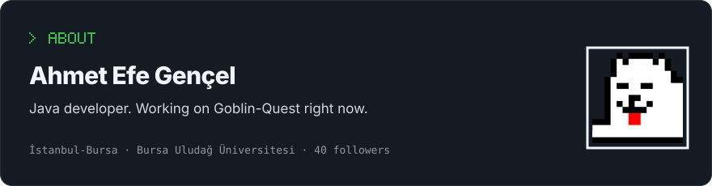
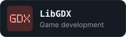
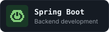
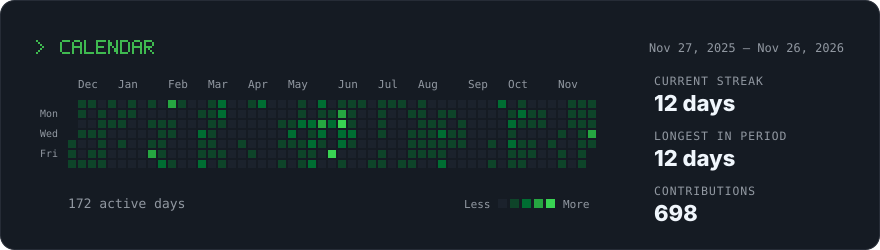

<picture>
  <source media="(prefers-color-scheme: light)" srcset="https://www.gitskins.com/api/section/pixel-room?username=progencel&mode=light&v=2026-11-25" />
  
</picture>The window shows the weather in İstanbul-Bursa right now. The monitor scrolls my latest commits; the shelf holds a book for each language I write.
  

<a href="https://github.com/ProGencel"><picture><source media="(prefers-color-scheme: light)" srcset="https://raw.githubusercontent.com/ProGencel/ProGencel/main/assets/pixel-widgets/github-light.svg" /></picture></a>
<a href="https://progencel.github.io/"><picture><source media="(prefers-color-scheme: light)" srcset="https://raw.githubusercontent.com/ProGencel/ProGencel/main/assets/pixel-widgets/portfolio-light.svg" /></picture></a>
<a href="https://progencel.itch.io/"><picture><source media="(prefers-color-scheme: light)" srcset="https://raw.githubusercontent.com/ProGencel/ProGencel/main/assets/pixel-widgets/itch-light.svg" /></picture></a>

<picture><source media="(prefers-color-scheme: light)" srcset="https://raw.githubusercontent.com/ProGencel/ProGencel/main/assets/pixel-widgets/about-light.svg" /></picture>

<picture>
  <source media="(prefers-color-scheme: light)" srcset="https://www.gitskins.com/api/section/pixel-hud?username=progencel&mode=light&v=2026-11-11" />
  
</picture>

<picture>
  <source media="(prefers-color-scheme: light)" srcset="https://www.gitskins.com/api/section/pixel-header?username=progencel&title=%3E+Tech+Stack&mode=light&v=2026-11-11" />
  
</picture><picture><source media="(prefers-color-scheme: light)" srcset="https://raw.githubusercontent.com/ProGencel/ProGencel/main/assets/pixel-widgets/libgdx-light.svg" /></picture>
<picture><source media="(prefers-color-scheme: light)" srcset="https://raw.githubusercontent.com/ProGencel/ProGencel/main/assets/pixel-widgets/spring-light.svg" /></picture>

  

<picture>
  <source media="(prefers-color-scheme: light)" srcset="https://www.gitskins.com/api/section/pixel-header?username=progencel&title=%3E+Coding+Activity&mode=light&v=2026-11-11" />
  
</picture>

<picture>
  <source media="(prefers-color-scheme: light)"
    srcset="https://raw.githubusercontent.com/ProGencel/ProGencel/wakatime-output/weekly-light.svg" />
  
</picture>

<picture>
  <source media="(prefers-color-scheme: light)"
    srcset="https://raw.githubusercontent.com/ProGencel/ProGencel/wakatime-output/all-time-light.svg" />
  
</picture>

<picture>
  <source media="(prefers-color-scheme: light)" srcset="https://www.gitskins.com/api/section/pixel-header?username=progencel&title=%3E+Projects&mode=light&v=2026-11-11" />
  
</picture>

<a href="https://github.com/ProGencel/Goblin-Quest"><picture><source media="(prefers-color-scheme: light)" srcset="https://www.gitskins.com/api/section/pixel-card?username=progencel&i=0&r=Goblin-Quest&mode=light&v=2026-11-11" /></picture></a>
<a href="https://github.com/ProGencel/FlappyDog"><picture><source media="(prefers-color-scheme: light)" srcset="https://www.gitskins.com/api/section/pixel-card?username=progencel&i=1&r=FlappyDog&mode=light&v=2026-11-11" /></picture></a>
<a href="https://github.com/ProGencel/Rectangle-Machine"><picture><source media="(prefers-color-scheme: light)" srcset="https://www.gitskins.com/api/section/pixel-card?username=progencel&i=2&r=Rectangle-Machine&mode=light&v=2026-11-11" /></picture></a>
<a href="https://github.com/ProGencel/TimeSheetApp"><picture><source media="(prefers-color-scheme: light)" srcset="https://www.gitskins.com/api/section/pixel-card?username=progencel&i=3&r=TimeSheetApp&mode=light&v=2026-11-11" /></picture></a>

<picture>
  <source media="(prefers-color-scheme: light)" srcset="https://www.gitskins.com/api/section/pixel-header?username=progencel&title=%3E+Activity&mode=light&v=2026-11-11" />
  
</picture>
<a href="https://github.com/ProGencel?tab=overview#js-contribution-activity"><picture><source media="(prefers-color-scheme: light)" srcset="https://raw.githubusercontent.com/ProGencel/ProGencel/main/assets/pixel-widgets/activity-light.svg" /></picture></a>

Pixel Studio · customized by ProGencel · base template made with <a href="https://www.gitskins.com/readme-generator">GitSkins</a>
